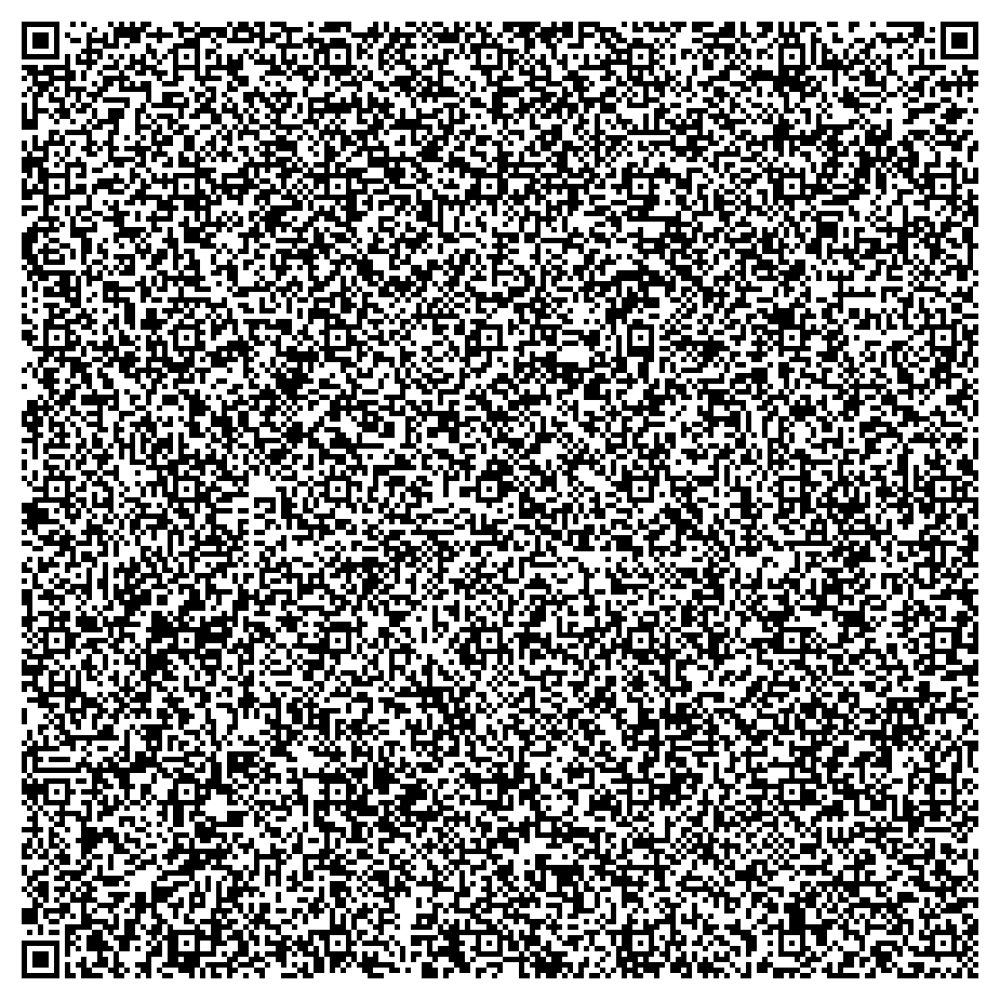
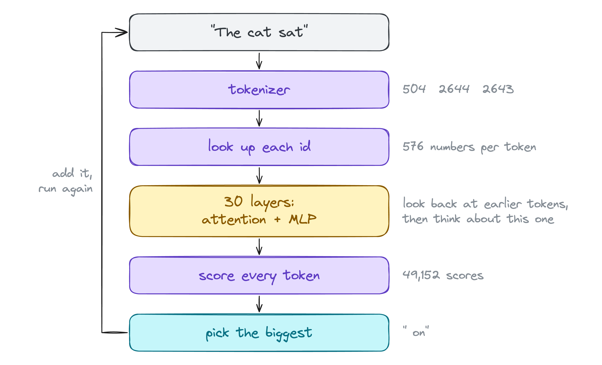
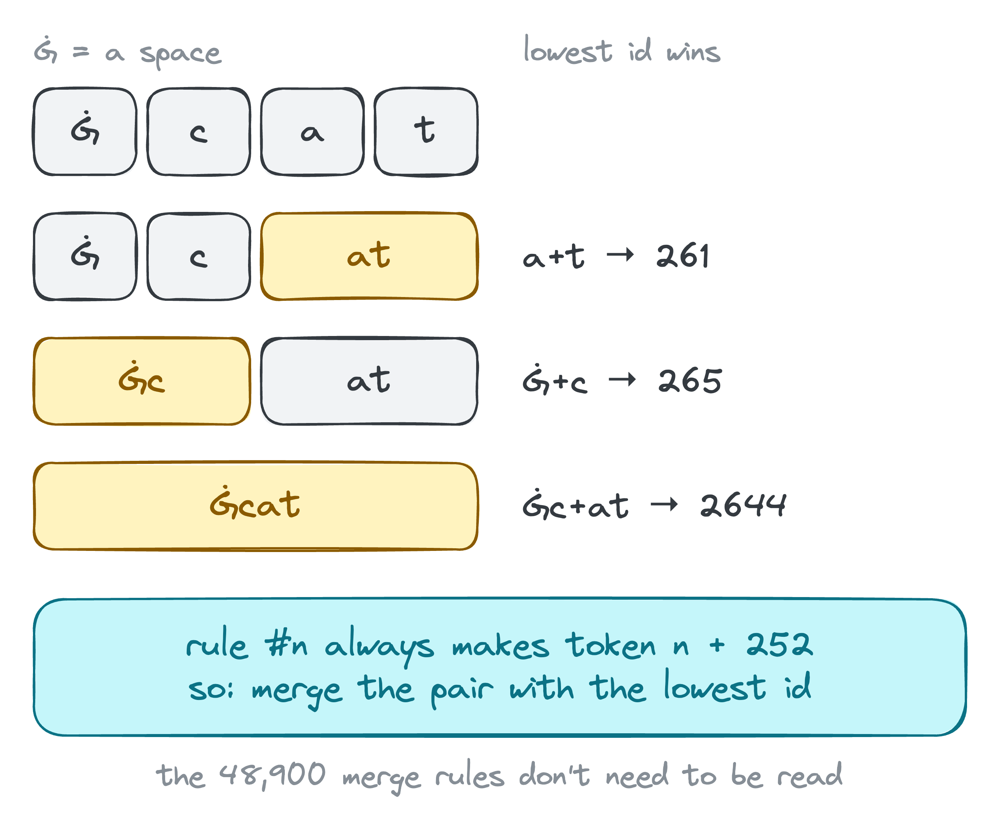
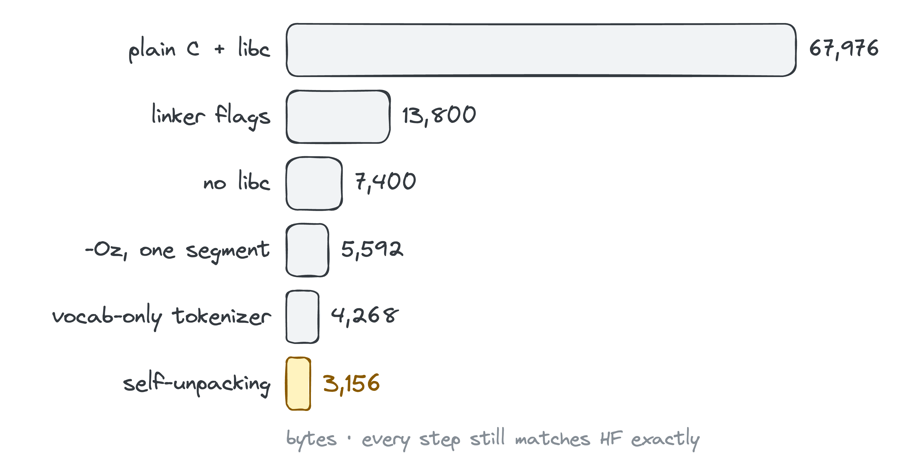
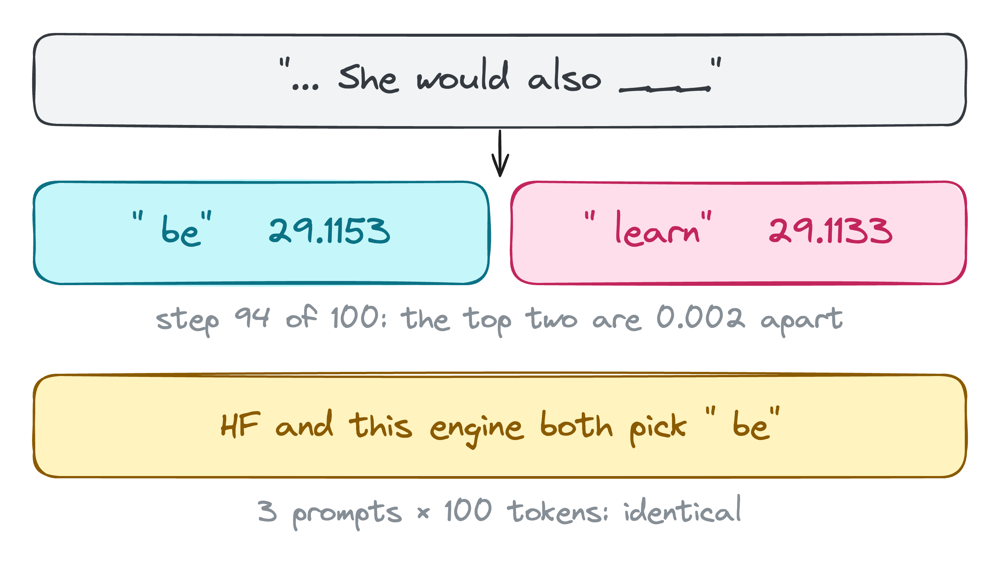

# bytesized: a 2,946-byte LLM engine

**How small can a program be and still talk?**

A C program that runs **SmolLM2-135M**, a real LLM, and produces **exactly** the same greedy tokens as Hugging Face transformers.
It reads the original `model.safetensors` and `tokenizer.json` with no converter.
The binary is **2,946 bytes** (Linux arm64), small enough to fit in a single QR code (max 2,953 bytes).



That QR code is the whole program. To get it back:

```bash
zbarimg --raw --oneshot -Sbinary qr.png > final && chmod +x final
```

Most phone camera apps treat QR codes as text and will mangle the binary, so use `zbarimg` (from zbar) on a computer.

```
$ ./smol
╭──────────────────────────────────────────────────────────╮
│ ✻ smol                                                   │
│                                                          │
│ engine  2,946 bytes of C                                 │
│ model   SmolLM2-135M, unmodified safetensors             │
│ decode  greedy, matches HF transformers token for token  │
╰──────────────────────────────────────────────────────────╯

> def fibonacci(n):
def fibonacci(n):
    if n == 0:
        return 0
    elif n == 1:
        return 1
    else:
        return fibonacci(n - 1) + fibonacci(n - 2)

print(fibonacci(10))

  end of text · 6.7s
```

`smol` is an optional Python front end. It only runs the binary and draws the screen, and it isn't part of the 2,946 bytes.
The engine on its own is `./final "prompt" [n_tokens]`.

## Rules

1. **Size** = bytes of the final binary. The model files are not counted.
2. **Correct** = greedy decoding, and the first 100 tokens match HF transformers (fp32) exactly. One different token = broken.
3. **Model files unmodified.** It reads the original `model.safetensors` and `tokenizer.json`.
4. **Speed** = same machine, same prompt, repeated runs, prompt length stated.

## Run it

You need arm64 Linux. I tested it in OrbStack on an M4 Mac. It should also work on a 64-bit Raspberry Pi 4/5 or AWS Graviton, but I haven't tried those.

```bash
# model files (original, from Hugging Face)
mkdir ~/smol && cd ~/smol
for f in model.safetensors tokenizer.json; do
  curl -LO https://huggingface.co/HuggingFaceTB/SmolLM2-135M/resolve/main/$f
done

# run (must be run from the model folder)
/path/to/bin/final "The cat sat" 50
/path/to/smol                    # the little CLI, SMOL_DIR=~/smol by default
```

## How it works (short)



- **Weights:** `mmap` the safetensors file. The header lists tensors in sorted order, so walk it by position instead of matching names: find the next `.`, then the next `ts` (the end of `data_offsets`). bf16 → fp32 is `bits << 16`.
- **Tokenizer:** byte-level BPE using only the vocab. In this tokenizer, merge rule *n* always creates token id *n + 252*, so "merge the pair with the lowest id" is exactly BPE. The 48,900 merges are never read.
- **Transformer:** embedding → 30 × (RMSNorm, attention with RoPE + GQA + KV cache, RMSNorm, SwiGLU MLP) → RMSNorm → tied embedding → argmax. About 40 lines.
- **No libc:** 5 raw syscalls (`openat`, `lseek`, `mmap`, `write`, `exit`). It has its own `exp` and `cos` (sin is `cos(a - π/2)`), computed in double precision so the results round the same way PyTorch's do.
- **Self-unpacking:** the file is a 112-byte ELF header, a 348-byte assembly unpacker and 2,486 bytes of compressed engine. It unpacks to 3,698 bytes in RAM, flushes the instruction cache and jumps in. The compression is LZ77 plus an LZMA-style range coder, with a separate model for each byte position of the 4-byte arm64 instructions. The program header overlaps the last 8 bytes of the ELF header (`hdr.py`).



## Size, step by step

Every row passed the exact-match check before the next change was made.



| # | change | bytes |
|---|---|---:|
| 1 | v0: plain readable C (`v0.c`), libc, `-O2`, stripped | 67,976 |
| 2 | linker: 4 KB pages instead of 64 KB, `--gc-sections`, lld | 13,800 |
| 3 | no libc: raw Linux syscalls, own `exp`/`sin`/`cos` (`tiny.c`) | 7,400 |
| 4 | `-Oz` | 6,256 |
| 5 | one RWX segment, no `.comment`, no section headers (`sstrip.py`) | 5,592 |
| 6 | tokenizer reads only the vocab; tensors found by header order | 4,268 |
| 7 | linker script: exactly one program header (`tiny.ld`) | 4,211 |
| 8 | GPT-2 byte table → arithmetic; dropped `exp` clamps that never trigger | 4,107 |
| 9 | pre-tokenizer rewritten around one character-class function | 4,019 |
| 10 | self-unpacking: LZ77 + Elias-gamma payload, C unpacker (`stub.c`) | 3,566 |
| 11 | unpacker rewritten in assembly (`stub.S`) | 3,422 |
| 12 | `-mno-outline` (repetition compresses better than outlined calls) | 3,375 |
| 13 | dropped 2 low-order precision constants | 3,303 |
| 14 | adaptive binary range coder instead of fixed bit codes (`rc.py`, `stubrc.S`) | 3,166 |
| 15 | match choice using the coder's learned costs (`rcopt.py`) | 3,156 |
| 16 | one `cos` instead of `sincos` with quadrant logic; shorter search keys (`.`, `ts`, `b":`); read exactly 49,152 vocab entries; no trailing newline; `-fomit-frame-pointer` | 3,041 |
| 17 | unpacker: probabilities stored as p − 2048 (no init loop), first coder byte dropped, match flag context = lane only; program header overlapping the ELF header (`hdr.py`) | 2,972 |
| 18 | 3 raw offset bits instead of 7; shorter gamma decoder | **2,946** |

## Verification



- `ref.py`: HF transformers, fp32, greedy, 100 new tokens for 3 prompts → `answer_key.json` (also stores the top-2 score gap at every step).
- `check.py BIN`: compares token IDs (from a `-DCHECK` build) or the decoded text against the answer key.
- `tokcheck.py BIN`: prompt tokenization vs the HF tokenizer on 12 tricky strings, plus 4 Unicode strings.
- Result: 3/3 prompts × 100 tokens identical. The closest step, in "Once upon a time" at step 94, had `" be"` 29.1153 vs `" learn"` 29.1133.

## Speed

M4, OrbStack Ubuntu VM, 1 thread. Prompt "The cat sat" (3 tokens) + 100 new tokens. 3 runs each; the times include loading.

| build | median | tok/s |
|---|---:|---:|
| v0 (libc, `-O2`) | 6.06 s | 16.5 |
| final (2,946 bytes, `-Oz`) | 10.62 s | 9.4 |

## Known limits

- **Linux arm64 only:** raw syscalls and an assembly unpacker.
- **The lowest-id BPE shortcut is tested, not proven.** Every merge result id = rank + 252 (checked for all 48,900). It matched real BPE on 122,463 distinct pieces (`bpe_sim.py`).
- **The pre-tokenizer treats every byte ≥ 0x80 as a letter.** It passed the accent, Japanese and emoji tests, but it isn't the full Unicode regex.
- Special tokens typed into the prompt (`<|endoftext|>`) are not mapped to their special IDs.
- No error handling. It must run in the model folder. Prompt + output ≤ 1024 tokens.
- It's a base model: it continues text, it doesn't chat.

## Build

Inside arm64 Linux with clang, lld and python3:

```bash
./pack.sh tiny.c final            # the 2,946-byte binary
./pack.sh tiny.c finalc -DCHECK   # same, but also prints token ids to stderr
./build.sh tiny.c tiny            # unpacked no-libc build (row 9)
clang -O2 -o v0 v0.c -lm          # readable reference
cd ~/smol && python3 /path/to/check.py /path/to/final
```

## Files

| file | what |
|---|---|
| `v0.c` | readable reference engine, with libc |
| `tiny.c` | the no-libc engine (265 lines) |
| `stubrc.S` | the 348-byte range-decoding unpacker |
| `rc.py`, `rcopt.py`, `lz.py` | the packer |
| `pack.sh`, `build.sh`, `tiny.ld`, `sstrip.py`, `hdr.py` | build and ELF shrinking |
| `ref.py`, `check.py`, `tokcheck.py`, `bpe_sim.py`, `bench.py` | verification and benchmarks |
| `smol` | optional terminal front end |

## Next ideas

- **Fit in a QR code.** Done: 2,946 bytes, 7 under the limit. The QR code above scans back byte-for-byte and runs.
- Put unpacker code into ELF header fields the kernel ignores.
- A context-mixing model instead of LZ + range coder.
- An x86-64 build.
